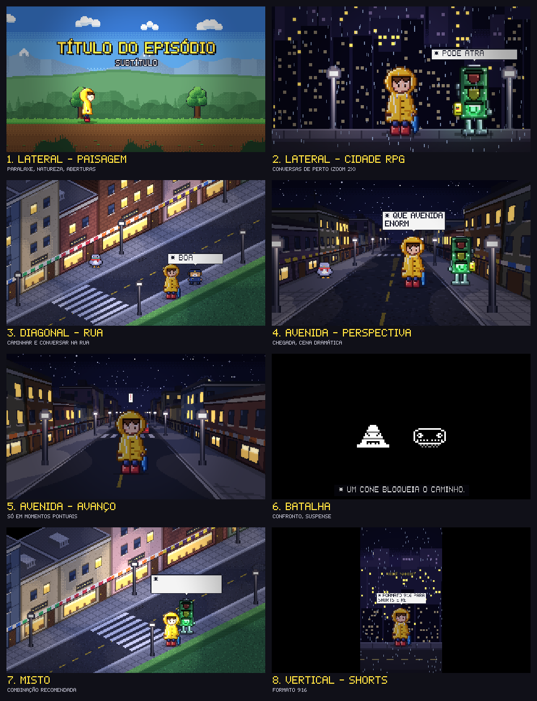

# Formas de fazer o vídeo

Guia de todas as formas que o gerador oferece, organizadas por tipo. Cada forma tem um **modelo pronto**
em `modelos/` — para começar um vídeo a partir dele:

```bash
npm run novo -- meu-video --modelo diagonal
```



---

## 1. Tipos de cena (vista e câmera)

Regra que vale para todos: **a câmera nunca gira para os lados** — assim os pixels continuam nítidos.
Cada cena do roteiro escolhe a sua forma, então dá para misturar várias no mesmo vídeo.

| # | Forma | Como ativar | Câmera | Melhor para | Evite | Modelo |
|---|---|---|---|---|---|---|
| 1 | **Lateral – paisagem** | `"fundo": "floresta-dia"` (padrão) | desliza de lado; `cameraFim`, `seguir` | aberturas, viagens, natureza, passagem de tempo | conversas longas de perto | `lateral-paisagem` |
| 2 | **Lateral – cidade RPG** | `"cenario": "cidade-rpg"` ou `"cidade-rpg-chuva"` | zoom 2×; acompanha com `seguir` | conversas de perto, personagens grandes | cenas que precisam mostrar a rua | `lateral-cidade-rpg` |
| 3 | **Diagonal – rua desenhada** | `"vista": "diagonal"` | desliza junto com `seguir` | caminhar e conversar pela rua | atravessar a rua (sem pose na diagonal) | `diagonal` |
| 4 | **Avenida – perspectiva** | `"vista": "avenida"` | **parada**; só acompanha o protagonista enquanto ele anda | chegada a um lugar, cenas dramáticas, contemplação | personagem andando para o fundo | `avenida` |
| 5 | **Avenida – avanço** | `"avenida": { "movimentoReal": true }` + ação `camera` em `z` | avança/recua de verdade | impacto, revelação — **só em momentos pontuais** | usar o tempo todo (pode tremer de leve) | `avenida-movimento` |
| 6 | **Batalha** | `"cenario": "batalha"` | fixa | confronto, suspense, "encontro" | — | `batalha` |

**Coordenadas por forma:**
- Lateral: `x` horizontal, `y` altura, `z` profundidade (negativo = fundo).
- Diagonal: `x` = posição **ao longo da rua**; `z` = distância a partir da calçada da frente (0 = calçada da frente, ~2,7 = meio da rua, ~5,3 = calçada dos prédios).
- Avenida: `x` lateral (−3 a 3 é o asfalto), `z` profundidade (maior = mais perto da câmera).

---

## 2. Estilos de personagem

| Estilo | Sprites | Visual | Quando usar |
|---|---|---|---|
| **Detalhado** (padrão para os principais) | `menina-capa`, `robo-semaforo` | 28×44 px, contorno colorido, 3 tons, respiração e piscar, andar 8 quadros, correr 8 quadros | protagonistas |
| **RPG indie** | `pombo-fofoqueiro`, `lixeira-timida`, `cao-guarda`, `fantasma-metro`, `coruja-banca`, `cone-agressivo`, `bueiro-olhos` | de frente, contorno grosso, olhos que piscam | coadjuvantes, cidade, batalha |
| **Simples (antigo)** | `heroi`, `amiga`, `velho`, `mago`, `slime`... `menina-capa-antigo`, `robo-semaforo-antigo` | 16 px, estilo plataforma | figurantes, cenas de paisagem |
| **Seu PNG** | `"sprite": "arquivo:nome.png"` | o seu desenho | personagens próprios do canal |

Use sempre pelos nomes da biblioteca (`"personagem": "menina-capa"`) — veja `npm run lista`.

---

## 3. Formatos de saída

| Formato | Como | Resultado |
|---|---|---|
| **Horizontal 16:9** (YouTube) | `"resolucao": [320, 180]` (padrão) | 1920×1080 |
| **Vertical 9:16** (Shorts, Reels, TikTok) | `"resolucao": [180, 320]` | 1080×1920 — modelo `vertical-shorts` |
| **Pixels maiores** | `"resolucao": [240, 135]` | 1920×1080 com cada pixel 8× (mais "retrô") |
| **60 fps** | `npm run final -- meu-video --fps 60` | movimento mais suave |

---

## 4. Modos de produção

| Modo | Comando | Para quê | O que sai |
|---|---|---|---|
| **Prévia** | `npm run previa -- meu-video` | ajustar posições e tempos em tempo real | navegador, sem áudio |
| **Rascunho** | `npm run rascunho -- meu-video` | conferir a história e o tempo da narração | 960×540, 15 fps, só narração, `storyboard.png` |
| **Final** | `npm run final -- meu-video` | publicar | 1080p, 30 fps, efeitos visuais, efeitos sonoros, ambiente, narração, −14 LUFS |

---

## 5. Acabamento visual (por vídeo ou por cena)

| Opção | Valores | Efeito |
|---|---|---|
| `transicao` | `fade`, `dither`, `iris`, `pixelizar`, `corte` | como a cena entra |
| `clima` | `chuva`, `neve`, `vagalumes`, `brasas`, `poeira`, `folhas` | partículas na tela |
| `paleta` | `nenhuma`, `posterizar`, `retro32`, `verde4`, `sepia`, `noir`, `quente`, `fria` | sépia/noir são ótimos para flashback |
| `periodo` (diagonal/avenida) | `noite`, `dia` | luzes acesas ou não |
| `efeitos` | `bloom`, `vinheta`, `aberracao` | brilho das luzes, cantos escuros, tremor colorido |
| `--crt` | — | linhas de TV antiga |

---

## 6. Som

| Fonte | Onde | Observação |
|---|---|---|
| **Narração (ElevenLabs)** | `projetos/meu-video/narracao/01.mp3, 02.mp3...` | a cena estica para caber a narração |
| **Efeitos automáticos** | gerados pelas ações (passos, pulo, moeda, explosão, fala...) | sem música, sem licença |
| **Ambiente** | automático pelo fundo/clima (chuva, grilos, cidade...) | `"ambiente": false` desliga |
| **Seus efeitos** | `biblioteca/sfx/` (todos os vídeos) ou `projetos/x/sfx/` | mesmo nome substitui o gerado |

---

## 7. Receita recomendada (modelo `misto`)

1. **Abertura:** avenida com avanço rápido de câmera e o título (forma 5).
2. **Desenvolvimento:** rua diagonal com os personagens caminhando e conversando (forma 3) e conversas de perto na lateral RPG (forma 2).
3. **Conflito:** batalha (forma 6).
4. **Fechamento:** lateral – paisagem com pôr do sol e "CONTINUA..." (forma 1).

Dicas:
- Use o **avanço de câmera** no máximo uma ou duas vezes por vídeo.
- Na avenida, deixe a câmera parada nas falas e só movimente quando o protagonista andar.
- Alterne vistas a cada mudança de lugar da história — isso dá ritmo sem precisar mover a câmera.
